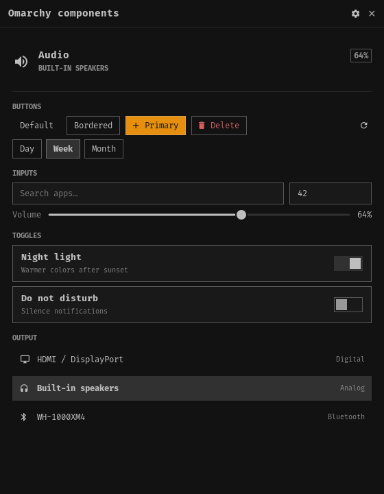
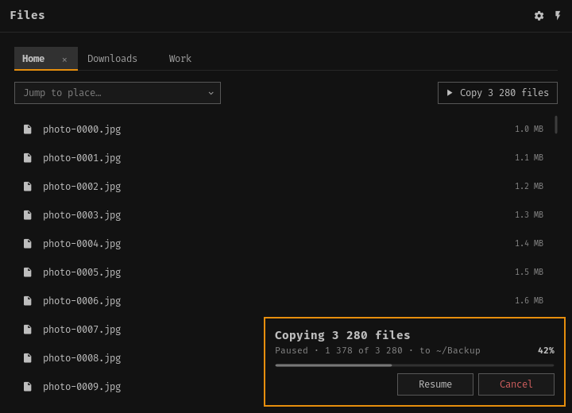

# lib-fltk-omarchy

Omarchy toolkit for [fltk-rs](https://github.com/fltk-rs/fltk-rs): the
classic Omarchy components (the omarchy-shell `Ui/` kit) ready to use, with
the live Omarchy theme, Hyprland window modes and small app helpers
(reactive state, cancellable background tasks, virtual lists, offscreen
snapshots). Import as `fltk_omarchy`. License MIT. Version 0.0.1, not
published.




- **Theme**: reads `~/.local/state/omarchy/current/theme/{colors,shell}.toml`
  and `~/.config/omarchy/shell.toml` with the same keys and defaults as
  omarchy-shell, Hyprland rounding/gaps, the `monospace` font; follows
  `omarchy-theme-set` live.
- **Components**: see [docs/COMPONENTS.md](docs/COMPONENTS.md).
- **Capabilities vs QML**: [docs/CAPABILITIES.md](docs/CAPABILITIES.md).
- **Measured** (same session, 520×400 app with a 100 000-row list): 13.8 MB
  PSS and 51 ms to first frame vs 45.5 MB / 123 ms (QML software) and
  90.0 MB / 192 ms (QML GPU) — method, a second session and limits in
  [docs/PERFORMANCE.md](docs/PERFORMANCE.md).
- **For agents**: [AGENTS.md](AGENTS.md).

```sh
cargo run --example gallery      # all components
cargo run --example overlays     # dropdown, menu, confirm, notification, list
cargo run --example app_shell    # Preferences/Actions menus, tabs, search, F1 help, operation toast
cargo test --offline             # unit + doc + main-thread UI tests
```

Use it from another crate (same fltk pin and features as this crate):

```toml
[dependencies]
fltk = { version = "=1.5.23", features = ["use-wayland", "no-images"] }
lib-fltk-omarchy = { git = "https://github.com/avillagran/lib-fltk-omarchy", tag = "v0.0.1" }
```

Requires the build dependencies of fltk-sys (cmake, a C++ compiler,
Wayland/X11/pango/cairo development files).
