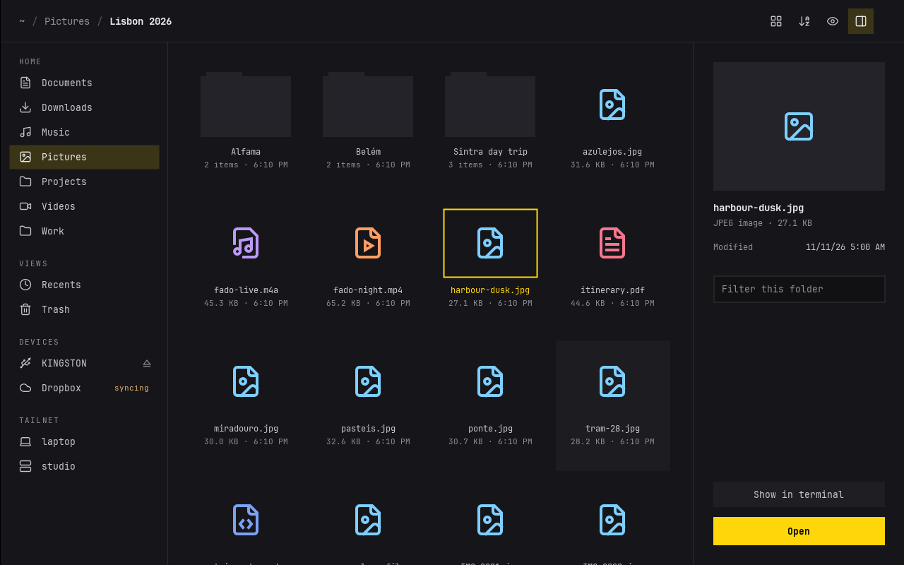

# lib-fltk-omarchy

An Omarchy toolkit for [FLTK](https://www.fltk.org) 1.4, written in C++17:
the live Omarchy theme, motion that follows Hyprland's animation switch,
keyboard-first widgets and small app helpers, for lightweight desktop apps
that start fast and use little memory.

## From Rust to C++

This toolkit started in Rust, on top of fltk-rs:
[avillagran/lib-fltk-omarchy-rust](https://github.com/avillagran/lib-fltk-omarchy-rust)
is the original project. It worked, but every Rust project carried gigabytes
of build output and long release builds for a small app. FLTK itself is C++,
so this version talks to it directly: no binding layer, a build folder of a
few megabytes, and the same low memory use.

The Rust project stays available as the reference for behavior and design
decisions; new work happens here.

## Status

Usable: theme, motion, processes, icons, text, translations and every
widget a Folio-like file manager needs (sidebar, breadcrumbs, a virtual
list/grid for big folders, menus, dialogs, toasts, tooltips, help
overlay, split panes). See [docs/API.md](docs/API.md) for a tour of every
module and [docs/components/](docs/components/) for screenshots.



The gallery (`examples/gallery.cpp`) idles at about **10 MiB PSS** in
Xvfb, against about 9 MiB for a bare FLTK window listing a folder.

## Building

Requires CMake 3.16+, a C++17 compiler and FLTK 1.4 (`pacman -S fltk` on
Arch).

```sh
cmake -S . -B build -DCMAKE_BUILD_TYPE=Release
cmake --build build
ctest --test-dir build
```

FLTK is linked **statically** by default, so apps built with the toolkit
run without the `fltk` package installed: it is a build-time dependency
only. Pass `-DFLTK_OMARCHY_SHARED_FLTK=ON` to link FLTK's shared libraries
instead. Other options: `FO_BUILD_EXAMPLES` and `FO_BUILD_TESTS` (both on).

A clean build of the library, the gallery and the tests takes about 5 s
with `-j24` (21 s on one core); the build folder is about 7 MB.

Use it from another CMake project:

```cmake
add_subdirectory(lib-fltk-omarchy)
target_link_libraries(myapp PRIVATE fltk-omarchy::fltk-omarchy)
```

```cpp
#include "fltk-omarchy/fo.h"

int main(int argc, char **argv) {
  fo::init();                                   // theme, fonts, language, motion
  auto *win = new fo::Window(1100, 700, "Flo");
  // ... fo::Sidebar, fo::Breadcrumbs, a fo::Collection subclass ...
  win->end();
  win->show(argc, argv);
  return Fl::run();
}
```

Tests run through ctest only: the runner creates a fresh private 0700
directory under `build/test-runs/` and points `HOME`, `TMPDIR` and every
XDG directory into it. Nothing there is ever deleted.

## Platforms

Linux (Wayland and X11) first. FLTK also runs on macOS and Windows, and the
toolkit keeps OS specifics behind one platform layer so it can follow.

## License

MIT. See [LICENSE](LICENSE). The embedded icons are from
[Lucide](https://lucide.dev) (ISC, see
[third_party/lucide/LICENSE](third_party/lucide/LICENSE)).
