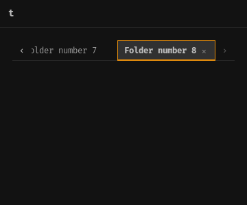
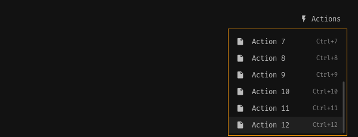
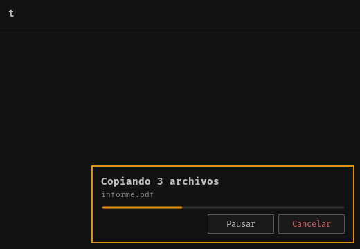
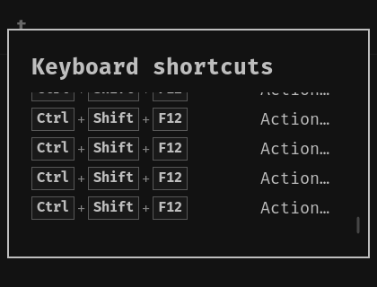
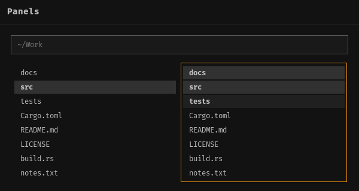
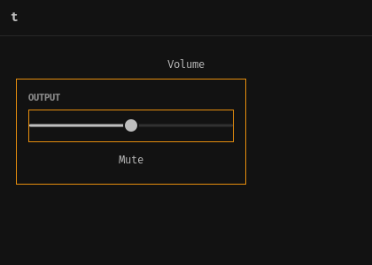
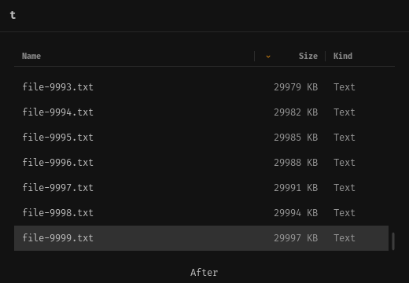
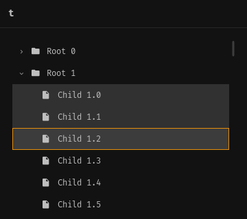
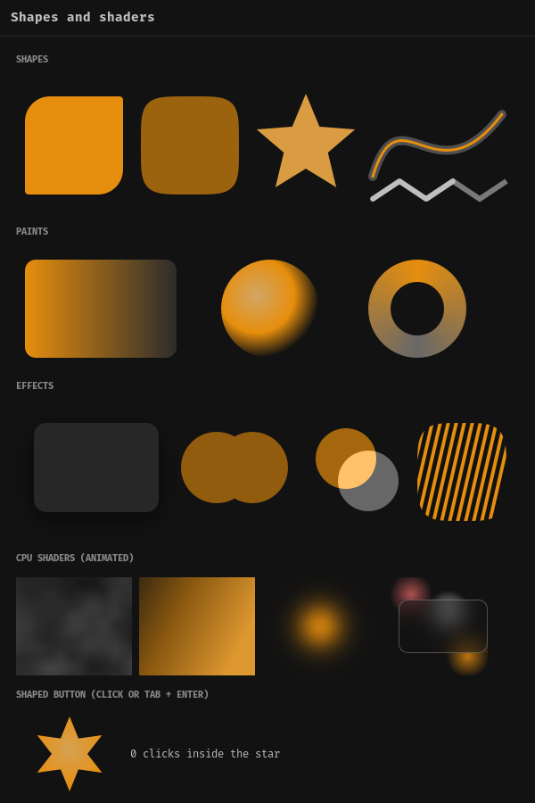

# Components (0.0.8)

Every component is a classic Omarchy control (the omarchy-shell `Ui/`
kit) drawn with the live theme: colors, fonts, spacing and corner radius
change when you run `omarchy-theme-set`. Each one derefs to an fltk widget,
so it goes in any `Flex`/`Group`; it is created with its Omarchy size and
`flex.fit(&*widget)` keeps that size.

You can drop the Rust handle: `row.fit(&*Toggle::new(..))` keeps following
its `State`, because bindings belong to the fltk widget and end when the
widget is deleted.

State changes animate with Omarchy's durations: Button 120 ms,
ActionButton and rows 60 ms, Toggle 100 ms, ToggleSwitch 120 ms with the
knob easing, Slider 140 ms (not while dragging). A theme change repaints at
once. `fltk_omarchy::anim::set_enabled(false)` or
`OMARCHY_FLTK_ANIMATIONS=0` turns transitions off.

Every component works from the keyboard. Tab and Shift+Tab move between
controls, arrows act inside the focused one, and menus give focus back when
they close. The keys of each component are listed below, and the whole
model is in [KEYBOARD.md](KEYBOARD.md).

The pictures are rendered offscreen by `cargo run --example docs_shots --
docs/components` with the Omarchy theme of the machine that ran it (here
Matte Black). The code under each picture is the code that drew it,
without the picture frame (a bare window with a padded column `col`).

Imports used below:

```rust
use fltk::prelude::*;
use fltk_omarchy::layout::{self, FlexExt};
use fltk_omarchy::widgets::{glyph, *};
use fltk_omarchy::{App, AppWindow, State};
```

## Buttons


```rust
let mut r = layout::row();
r.fit(&*Button::new("Default"));
r.fit(&*Button::new("Bordered").bordered());
r.fit(&*Button::icon(glyph::PLUS, "New").primary().on_click(|| println!("new")));
r.fit(&*Button::icon(glyph::TRASH, "Delete").danger().bordered());
r.fit(&*ActionButton::new(glyph::REFRESH, "Refresh"));       // icon only, tooltip
r.fit(&*ActionButton::destructive(glyph::CLOSE, "Close"));
r.close_fitted();
```

More: `.shortcut("Ctrl+S")`, `.tooltip(..)`, `.left_aligned()`,
`.bind_text(&State<String>)`, `.bind_enabled(&State<bool>)`, `click()`.
**Keys:** Tab to focus, Enter or Space to press; `.shortcut(..)` works from
anywhere in the window.

## ButtonGroup


```rust
let period = State::new(1usize);              // selected index
let mut r = layout::row();
r.fit(&*ButtonGroup::new(&["Day", "Week", "Month"], &period));
r.close_fitted();
```

**Keys:** one Tab stop (the selected button); Left/Right change the
selection.

## TextField and NumberField


```rust
let query = State::new(String::new());
col.fit(&*TextField::new().placeholder("Search apps…").bind(&query));   // two-way
let name = State::new("Omarchy".to_string());
col.fit(&*TextField::new().bind(&name));
let mut r = layout::row();
r.fit(&*TextField::password().placeholder("Password"));
r.fit(&*NumberField::new(&State::new(42), 0, 100, 1));
r.close_fitted();
```

More: `.on_change(|text| ..)`, `.on_submit(|text| ..)`, `type_text(..)`.
**Keys:** type; Enter submits; Up/Down step the NumberField.

## ToggleSwitch and Toggle


```rust
let wifi = State::new(true);
let mut r = layout::row();
r.fit(&*Label::new("Wi-Fi"));
layout::spacer();
r.fit(&*ToggleSwitch::new(&wifi));
r.close_fitted();
col.fit(&*Toggle::new("Night light", "Warmer colors after sunset", &State::new(true)));
col.fit(&*Toggle::new("Do not disturb", "Silence notifications", &State::new(false)));
```

**Keys:** Enter or Space flip it.

## Slider and Progress


```rust
let volume = State::new(0.64);
let mut r = layout::row();
r.fit(&*Label::new("Volume"));
let _slider = Slider::new(&volume, 0.0, 1.0, 0.05);             // stretches
r.fit(&*Label::new("").right().bind(&volume.map(|v| format!("{:.0}%", v * 100.0))));
r.close_fitted();
col.fit(&*Progress::new(&State::new(0.42)));                     // 0..1
```

**Keys:** Left/Right or Up/Down move the Slider by one step.

## Text styles, Hero, Separator


```rust
col.fit(&*Hero::new(glyph::VOLUME_HIGH, "Audio", "Built-in speakers").detail("64%"));
col.fit(&*Separator::new());
col.fit(&*Label::section("Output"));                   // PanelSectionHeader
col.fit(&*Label::styled("Title text", TextStyle::Title));
col.fit(&*Label::new("Body text"));
col.fit(&*Label::new("Dim caption").tone(Tone::Dim));
```

More: `.bold()`, `.center()`, `.right()`, `.bind(&State<String>)`.

## Row


```rust
col.fit(&*Row::new(glyph::MONITOR, "HDMI / DisplayPort").detail("Digital"));
col.fit(&*Row::new(glyph::HEADPHONES, "Built-in speakers").detail("Analog").current(true));
col.fit(&*Row::new(glyph::BLUETOOTH, "WH-1000XM4").detail("Bluetooth").on_click(|| println!("connect")));
```

**Keys:** Tab to focus, Enter or Space to activate.

## TabBar


```rust
let tab = State::new(1usize);
col.fit(&*TabBar::new(&["Home", "Downloads", "Work"], &tab).on_close(|i| println!("close {i}")));
```

More: `set_tabs(..)`, `request_close(i)`; a middle click closes a tab.

When the tabs do not fit, ‹ › arrows appear at the edges and the strip
scrolls with them or with the wheel. The selected tab, close glyph
included, is scrolled into view (`overflowing()`, `scroll_offset()`,
`tab_rect(i)`).



**Keys:** Ctrl+Tab / Ctrl+PageDown go to the next tab and Ctrl+Shift+Tab /
Ctrl+PageUp to the previous one, from anywhere in the window. When the bar
has focus, Left/Right/Home/End pick a tab and Delete closes it.

## Dropdown


```rust
use fltk_omarchy::overlay::Dropdown;
let output = State::new(0usize);
col.fit(&*Dropdown::new("Output", &["Speakers", "Headphones", "HDMI"], &output));
```

**Keys:** Enter, Space or Down open it; Up/Down or j/k move; Enter picks;
Esc closes. Focus returns to the trigger.

## SearchableDropdown


```rust
use fltk_omarchy::popups::SearchableDropdown;
let place = State::new(None::<usize>);
let places = vec![
    ("Home".to_string(), "~/".to_string()),
    ("Downloads".to_string(), "~/Downloads".to_string()),
    ("Work".to_string(), "~/Work".to_string()),
    ("Pictures".to_string(), "~/Pictures".to_string()),
];
col.fit(&*SearchableDropdown::new("Go to…", places, &place));
```

**Keys:** Enter or Down open it; type to filter by label or description;
Up/Down move; Enter picks; Esc closes.

## List (virtual)


```rust
use fltk_omarchy::list::{List, ListRow};
let count = State::new(100_000usize);
let selected = State::new(Some(2usize));
let list = List::new(&count, |i| ListRow::new(&format!("Item {i}")).icon(glyph::FILE).detail(&format!("{} KB", i * 3)))
    .bind_selected(&selected)
    .on_activate(|i| println!("open {i}"));
```

Only the visible rows are built: 1 000 000 rows cost the same per frame as
20. **Keys:** Up/Down or j/k move the cursor row; PageUp/PageDown, Home/End;
Enter opens (`on_activate`).

## PopupMenu (Preferences / Actions / context menus)


```rust
use fltk_omarchy::popups::{PopupItem, PopupMenu};
PopupMenu::open(&*actions_button, vec![
    PopupItem::new(glyph::FOLDER, "Open").shortcut("Enter"),
    PopupItem::new(glyph::SEARCH, "Preview").shortcut("Space").divider(),
    PopupItem::new(glyph::FILE, "Copy").shortcut("Ctrl+C"),
    PopupItem::new(glyph::FILE, "Show hidden files").checked(true),
    PopupItem::new(glyph::TRASH, "Move to trash").shortcut("Delete").disabled(),
], |index| println!("picked {index}"));
```

`PopupMenu::open_at(&*win, x, y, items, f)` opens it at a point (context
menu).

A menu taller than the window is clamped to it and scrolls (wheel and
keys) and keeps the active entry visible. It opens below the anchor, or
above it when there is more room there. A label that is too wide ends in
"…" and keeps its shortcut.



```rust
let items: Vec<PopupItem> = (1..=12).map(|i| PopupItem::new(glyph::FILE, &format!("Action {i}")).shortcut(&format!("Ctrl+{i}"))).collect();
let menu = PopupMenu::open(&*more, items, |i| println!("picked {i}"))
    .on_dismiss(|reason| println!("closed: {reason:?}"));   // Picked(i), Escape, ClickOutside, Closed
// picture: after End
menu.close();                                              // e.g. the data changed
```

`open` returns a `PopupHandle`:
- `.on_dismiss(|reason| ..)` runs once with `Dismiss::Picked(i)`, `Escape`,
  `ClickOutside` or `Closed`.
- `.close()` closes the menu without picking.
- `.is_open()`, `.dismissed()` and `.rect()` report its state.

Dropping the handle leaves the menu open. If the window is deleted with the
menu open, no callback runs.

App shortcuts work while the menu is open. A key the menu does not use
(F1, F10, `Ctrl+,`, `Ctrl+j`) closes it with `Dismiss::Closed`, gives focus
back and then runs the window shortcut once. `j` / `k` navigate only with
no modifier. See [KEYBOARD.md](KEYBOARD.md#popups-and-app-shortcuts).

**Keys:** Up/Down or j/k move, skip disabled entries and wrap;
PageUp/PageDown and Home/End jump; Enter picks; Esc closes; Tab stays in
the menu. Focus returns to the control that had it.

## Menu (Omarchy menu, type to filter)


```rust
use fltk_omarchy::overlay::{Menu, MenuItem};
Menu::open(&*win, "Go", vec![
    MenuItem::new(glyph::SEARCH, "Apps").detail("launch an app"),
    MenuItem::new(glyph::MONITOR, "Screenshot").detail("capture the screen"),
    MenuItem::new(glyph::MONITOR, "Screen record").detail("record the screen"),
    MenuItem::new(glyph::SETTINGS, "Setup").submenu(),
], |index| println!("picked {index}"));
// picture: after typing "sc"
```

**Keys:** type to filter; Up/Down, PageUp/PageDown; Enter or Right pick;
Backspace / Ctrl+Backspace / Ctrl+U edit the filter; Esc clears the filter,
then closes.

## ConfirmDialog


```rust
use fltk_omarchy::overlay::ConfirmDialog;
ConfirmDialog::open(&*win, "Move 3 files to the trash?", "Move", true, |ok| println!("confirmed: {ok}"));
```

**Keys:** Left/Right/Tab switch buttons; Enter activates; Esc cancels.

## Notification


```rust
use fltk_omarchy::overlay::{Notification, Urgency};
Notification::show(&*win, glyph::BELL, "Copied 3 files", "to ~/Work/reports", Urgency::Normal);
Notification::show(&*win, glyph::WIFI, "Connected", "", Urgency::Low);
```

Low hides after 5 s, Normal after 8 s, Critical stays until dismissed.
**Keys:** Tab reaches a notification; Enter, Space, Delete or Esc dismiss it.

## OperationToast


```rust
use fltk_omarchy::popups::OperationToast;
let mut op = OperationToast::show(&*win, "Copying 3 files").unwrap()
    .on_pause(|paused| println!("paused: {paused}"))
    .on_cancel(|| println!("cancel"));
op.set_progress(0.42);                       // from a Task's on_progress
op.set_detail("report.pdf · 12 of 30 MB");
// op.close() when the task ends
```

Localized labels, progress of unknown length, and the card follows the
window's bottom-right corner when the window is resized:



```rust
let mut op = OperationToast::show(&*win, "Copiando 3 archivos").unwrap()
    .labels("Pausar", "Reanudar", "Cancelar", "En pausa");
op.set_indeterminate(true);   // a sliding bar instead of a percentage
```

**Keys:** Tab reaches it (or call `op.focus()` from a window shortcut);
Left/Right choose Pause or Cancel; Enter or Space press; Esc gives focus
back without cancelling.

## ShortcutHelp (F1)


```rust
use fltk_omarchy::popups::ShortcutHelp;
let row = |k: &str, d: &str| (k.to_string(), d.to_string());
let help = move || vec![
    ("Move".into(), vec![row("Tab", "Next control"), row("Shift+Tab", "Previous control"), row("Ctrl+Tab", "Next tab")]),
    ("Files".into(), vec![row("Enter", "Open"), row("F2", "Rename"), row("Delete", "Move to trash")]),
    ("Window".into(), vec![row("Ctrl+,", "Preferences"), row("F10", "Actions"), row("F1", "This help")]),
];
let w = win.clone();
win.shortcut("F1", move || { ShortcutHelp::open(&*w, "Keyboard shortcuts", help()); });
```

`open` returns a handle with `scroll()` and `max_scroll()`. Scrolling is
bounded to the content, and a scrollbar shows when there is more. Below,
a 420×320 window at font size 18, after End:



**Keys:** Up/Down, PageUp/PageDown, Home/End scroll; Esc or F1 close.

## AppWindow


```rust
let app = App::new("dev.example.notes");
let mut win = AppWindow::new("Notes", 600, 260);   // the body column is open
win.header().action(glyph::SETTINGS, "Preferences", || {});
win.header().action("\u{f0241}", "Actions", || {});
win.header().destructive_action(glyph::CLOSE, "Close", || fltk::app::quit());
let mut body = win.body();
body.fit(&*TextField::new().placeholder("Title"));
body.fit(&*Toggle::new("Pinned", "Keep at the top of the list", &State::new(true)));
let mut r = layout::row();
layout::spacer();
r.fit(&*Button::new("Cancel").bordered());
r.fit(&*Button::new("Save").primary());
r.close_fitted();
win.end();
win.show();
app.run();
```

More: `set_mode(Mode::Normal | Floating | Fullscreen)`,
`shortcut("Ctrl+Q", f)`, `set_min_size`, `snapshot(path)`. Header actions
are buttons: Tab reaches them.

A floating window moves when you drag its title and resizes from its
bottom corners. Both go through the compositor's own interactive gesture
(`native::begin_move` / `begin_resize`, the libdecor/xdg_toplevel path,
no compositor IPC). Hyprland IPC remains as a fallback. In Hyprland the
window still opens floating at its size: it maps normally and is floated
right away, so it can be tiled (`Mode::Normal`) and resized later.

## KeyboardPanel (regions of one canvas)



A file manager draws its views and both panes in one virtualized canvas,
with no widget per file. A `KeyboardPanel` turns each region of that canvas
into a real Tab stop, with its own cursor and a selection kept by stable
IDs:

```rust
use fltk_omarchy::{focus, panel::{KeyboardPanel, PanelLayout}};
let left = KeyboardPanel::new("left");
let right = KeyboardPanel::new("right");                 // .layout(PanelLayout::Grid { columns: 4 }) for a grid
for p in [&left, &right] {
    // len, ID at an index, index of an ID: call again after refresh/sort/filter
    p.set_items(names.len(), |i| 100 + i as u64, |id| id.checked_sub(100).map(|x| x as usize));
}
let mut canvas = fltk::widget::Widget::default().with_size(560, 200);
canvas.handle(|_, ev| matches!(ev, fltk::enums::Event::Focus | fltk::enums::Event::Unfocus));
canvas.draw(/* rows: p.cursor(), p.is_selected(id); ring when p.show_ring() */);
body.fit(&canvas);
focus::host(&canvas, &[&left, &right]);                 // Tab: path → left → right → …
left.on_activate(|id| println!("open {id}"));
let r3 = right.clone();
left.on_edge(move |k| k == fltk::enums::Key::Right && { r3.focus(); true });
// picture: Tab, Down, Down (left: "src"); Tab, Down, Shift+Down, Shift+Down (right: a range)
```

**Keys:**
- Up/Down move the cursor, and Left/Right too in a grid. The selection
  becomes that item.
- Ctrl+move moves the cursor only.
- Shift+move selects the range from the anchor; Ctrl+Shift+move adds the
  range.
- PageUp/PageDown and Home/End jump.
- Ctrl+Space toggles the item; Ctrl+A selects everything.
- Enter runs `on_activate`.

Keys the panel does not use, such as the app's own Ctrl+Tab, reach the
host widget and the window shortcuts exactly once. Mouse: call
`p.click(id, ctrl, shift)` from the canvas handler. Also:
`select_range`, `invert_selection`, `clear_selection`, `selection()` (in
display order) and `focus::focused_panel()`.

## PopupCard



```rust
use fltk_omarchy::popups::PopupCard;
let vol = State::new(0.5);
let card = PopupCard::open(&*volume_button, 260, 120, move |col| {
    col.fit(&*Label::section("Output"));
    let _s = Slider::new(&vol, 0.0, 1.0, 0.1);
    col.fit(&*Button::new("Mute"));
}).on_dismiss(|why| println!("{why:?}"));      // Escape, ClickOutside, Closed
```

It is anchored like `PopupMenu` (below, or above when there is more room)
and clamped to the window. **Keys:** focus goes to the first control
inside; Tab and Shift+Tab stay in the card; Esc closes and focus goes back.

## Table and Tree (virtual, on a KeyboardPanel)



```rust
use fltk_omarchy::{panel::KeyboardPanel, table::{Column, Table}};
let panel = KeyboardPanel::new("files");
panel.set_items(n, |i| id_of(i), |id| index_of(id));    // stable IDs, display order
let table = Table::new(&panel, vec![Column::new("Name", 0).flex(), Column::new("Size", 90).right(), Column::new("Kind", 80)],
    |row, col| cell_text(row, col))
    .icon(|row| glyph::FILE.to_string())
    .on_sort(|col, ascending| { /* sort, then panel.set_items(..) again */ });
```

Only visible rows are drawn (10 000 rows: at most 20 drawn per frame in the test). Click a
header to sort (the chevron shows the direction); drag a column edge to
resize it. Selection, cursor and keys come from the panel: Ctrl/Shift
ranges, Ctrl+Space, Ctrl+A, PageUp/PageDown, Home/End, Enter
(`on_activate`). Double click activates.



```rust
use fltk_omarchy::table::{Tree, TreeNode};
let panel = KeyboardPanel::new("tree");
let tree = Tree::new(&panel, |parent| match parent {
    None => roots(),                                   // Vec<TreeNode>
    Some(id) => children_of(id),                       // asked for on first expand only
});
// TreeNode::new(id, "Pictures").icon(glyph::FOLDER).branch()
```

Children are fetched lazily and cached. Call `tree.refresh()` after the
data changes, or `refresh_node(Some(id))` for one folder. **Keys:** the
panel's, plus Right (expand, then first child) and Left (collapse, then
parent). Click the chevron to toggle; double click a branch toggles it,
a leaf activates.

## Keyboard focus


The same window driven only by keys: Tab, Right (ButtonGroup → Week); Tab,
Ctrl+Tab (TabBar → Downloads); Tab, Down, Down (List → Item 1). The focused
control gets the accent ring. See [KEYBOARD.md](KEYBOARD.md).

## Custom shapes and shaders (`gfx`)



```rust
use fltk_omarchy::gfx::{self, Hit, Paint, Path, Stroke, View};
let card = View::new(240, 120).paint(|c, u| {
    let shape = Path::rounded_rect(8.0, 8.0, 224.0, 104.0, [16.0, 16.0, 4.0, 4.0]);
    c.shadow(&shape, 0.0, 4.0, 8, u.foreground.with_alpha(0.35));
    c.fill(&shape, Paint::linear((0.0, 0.0), (240.0, 0.0), &[(0.0, u.accent), (1.0, u.background)]));
    c.stroke(&shape, &Stroke::new(1.5), u.foreground.with_alpha(0.4));
});
let glow = View::new(240, 120).shader(gfx::shaders::accent_glow()).animate(gfx::Rate::Display);   // GPU or CPU: the toolkit decides
```

Paths, gradients, shadows, blur, blend modes, clips, layers, CPU shaders
with an area limit and a time budget, and shape hit-testing: all in
[SHADERS.md](SHADERS.md).

## Reference

| Omarchy (`shell/Ui`) | Rust | Main API |
|---|---|---|
| Button | `widgets::Button` | `new`, `icon`, `.primary()`, `.bordered()`, `.danger()`, `.left_aligned()`, `.tooltip()`, `.shortcut()`, `.on_click()`, `.bind_text()`, `.bind_enabled()`, `set_selected`, `click()` |
| PanelActionButton | `widgets::ActionButton` | `new(glyph, tooltip)`, `destructive(..)`, `.on_click()` |
| ButtonGroup | `widgets::ButtonGroup` | `new(&labels, &State<usize>)`, `selected()`, `button(i)` |
| TextField | `widgets::TextField` | `new()`, `password()`, `.placeholder()`, `.bind()`, `.on_change()`, `.on_submit()`, `type_text()`, `input()` |
| NumberField | `widgets::NumberField` | `new(&State<i64>, from, to, step)` |
| ToggleSwitch / Toggle | `widgets::ToggleSwitch`, `widgets::Toggle` | `new(&State<bool>)`, `new(title, description, &State<bool>)` |
| PanelSlider / progress | `widgets::Slider`, `widgets::Progress` | `new(&State<f64>, min, max, step)`, `new(&State<f64>)` |
| text tokens | `widgets::Label` | `new`, `styled(text, TextStyle::..)`, `section(..)`, `.bold()`, `.tone()`, `.center()`, `.right()`, `.bind()` |
| PanelHero / PanelSeparator | `widgets::Hero`, `widgets::Separator` | `new(glyph, title, meta).detail(..)`, `new()` |
| CursorSurface row | `widgets::Row` | `new(glyph, label)`, `.detail()`, `.current()`, `.on_click()` |
| tabs | `widgets::TabBar` | `new(&labels, &State<usize>)`, `.on_close()`, `set_tabs`, `request_close` |
| Dropdown | `overlay::Dropdown` | `new(label, &options, &State<usize>)`, `open()`, `set_options` |
| SearchableDropdown | `popups::SearchableDropdown` | `new(placeholder, vec![(label, description)], &State<Option<usize>>)`, `open()`, `filter()` |
| list | `list::List` | `new(&State<usize>, \|i\| ListRow)`, `.bind_selected()`, `.on_select()`, `.on_activate()`, `select(i)` |
| header / context menus | `popups::PopupMenu` | `open(&anchor, items, f)` / `open_at(&win, x, y, items, f)` → `PopupHandle` (`.on_dismiss()`, `.close()`, `.is_open()`, `.rect()`) |
| popup card | `popups::PopupCard` | `open(&anchor, w, h, \|col\| ..)` / `open_at(..)` → `PopupHandle` |
| table / tree | `table::Table`, `table::Tree` | `Table::new(&panel, columns, \|row, col\| text)`, `.icon()`, `.on_sort()`; `Tree::new(&panel, \|parent\| nodes)`, `expand`, `collapse`, `refresh`, `refresh_node` |
| keyboard panel | `panel::KeyboardPanel` | `new(name)`, `.layout()`, `set_items(len, id_at, index_of)`, `cursor()`, `selection()`, `click()`, `focus()`, `show_ring()`, `.on_activate()`, `.on_edge()`, `.on_key()`, `.on_change()`; `focus::host(&widget, &[&a, &b])` |
| menu plugin | `overlay::Menu` | `open(&win, title, items, f)` |
| ConfirmDialog | `overlay::ConfirmDialog` | `open(&win, message, confirm, destructive, f)` |
| notifications | `overlay::Notification` | `show(&win, glyph, summary, body, Urgency::..)`, `count()` |
| operations tray | `popups::OperationToast` | `show(&win, title)`, `.on_pause()`, `.on_cancel()`, `set_progress`, `set_detail`, `focus()`, `close()` |
| F1 help | `popups::ShortcutHelp` | `open(&win, title, sections)` |
| PanelToolTip | fltk tooltips | styled globally; `.tooltip()` / `set_tooltip` |
| custom visuals | `gfx::View`, `gfx::Path`, `gfx::Paint`, `gfx::sl` | `View::new(w, h).paint(\|c, u\| ..)` / `.shader(sl::Shader)` / `.animate(Rate::Display)` / `.hit_shape(Hit::Fill(path))` / `.on_click(f)` — [SHADERS.md](SHADERS.md) |
| window | `AppWindow` | `new`, `header().action(..)`, `body()`, `end()`, `show()`, `set_mode()`, `shortcut()`, `snapshot()` |

Interior corners are an app preference: `theme::set_corners(Corners::Omarchy |
Square | Rounded)`; it survives theme reloads. Thumbnails, type badges and
previews use `theme.badge_radius()`, which stays curved. The focus ring is
another preference: `theme::set_focus_ring(FocusRing::Accent | Theme)`.

Glyphs: `widgets::glyph::*` (chevron, refresh, settings, wifi, bluetooth,
volume, headphones, monitor, plus, play, stop, trash, search, folder, file…).
