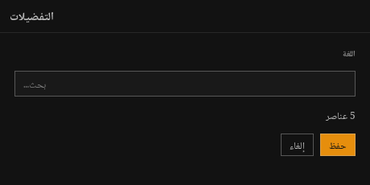
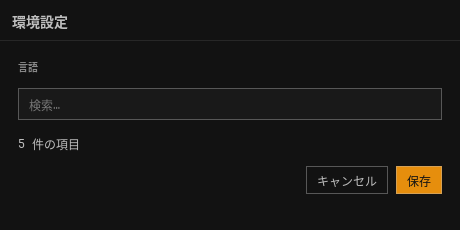
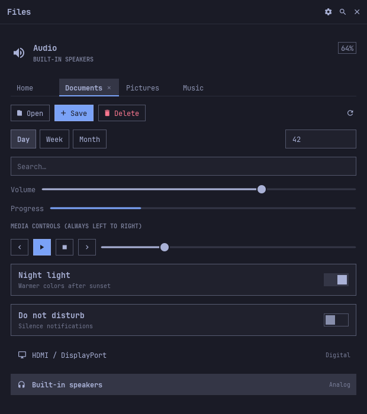
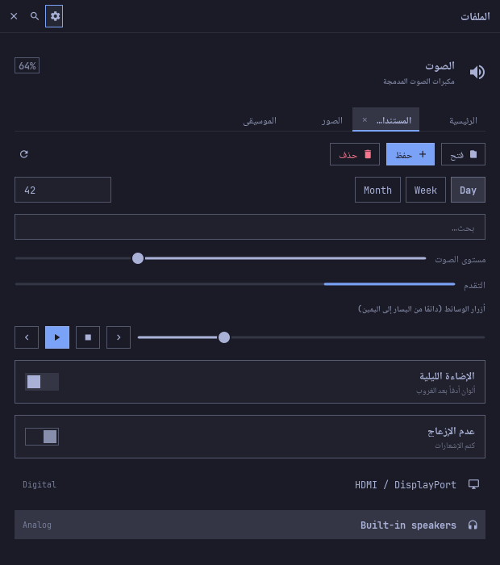

# Translations (`i18n`)

Every user-visible string goes through `fltk_omarchy::i18n`. Catalogs use
o3's format, so an o3 catalog loads as is; the language follows the system
and can be switched live; the toolkit's own strings are already translated
into 20 languages.

| Arabic | Japanese |
|---|---|
|  |  |

```rust
for loc in ["ar", "ja"] {
    i18n::set_locale(loc);
    let mut w = AppWindow::new("", 460, 230);
    w.bind_title(&i18n::text("Preferences"));
    let mut body = w.body();
    body.fit(&*Label::section("").bind(&i18n::text("Language")));
    body.fit(&*TextField::new().bind_placeholder(&i18n::text("Search…")));
    let n = State::new(5);
    body.fit(&*Label::new("").bind(&i18n::map(&n, |n| trn!("{count} items", *n))));
    let mut r = layout::row();
    layout::spacer();
    r.fit(&*Button::new("").bordered().bind_text(&i18n::text("Cancel")));
    r.fit(&*Button::new("").primary().bind_text(&i18n::text("Save")));
    r.close_fitted();
    w.end();
    // ...
}
```

## Quick start

```rust
use fltk_omarchy::{i18n, tr, trn, widgets::*, State};

// App strings on top of the toolkit catalog (an app key overrides a toolkit key).
i18n::load(include_str!("../i18n/app.json")).unwrap();

tr!("Open");                                   // "Abrir" in Spanish
tr!("Delete {name}?", name = file);            // named placeholders, any Display
trn!("{count} files", n);                      // plural form of the current language
trn!("{count} files in {dir}", n, dir = path);

// Live: re-translated when the language changes, no window rebuild.
let open = Button::new("").bind_text(&i18n::text("Open"));
let files = Label::new("").bind(&i18n::map(&count, |n| trn!("{count} files", *n)));
win.bind_title(&i18n::text("Files"));
header_action.bind_tooltip(&i18n::text("Preferences"));

i18n::set_locale("es");      // or "pt_BR.UTF-8", "fr-CA:en"; i18n::follow_system() to go back
```

Without a translation the lookup returns the English key itself, so an app
works (in English) before its catalog exists.

## Catalog format

o3's `translations/i18n.json`: one flat JSON object per locale, keys are the
English source strings, values are strings.

```json
{
  "en": { "Open": "Open", "Delete {name}?": "Delete {name}?" },
  "es": { "Open": "Abrir", "Delete {name}?": "¿Eliminar {name}?" },
  "pt": { "Open": "Abrir" }
}
```

- **Lookup order** for the requested list (`fr_CA.UTF-8:de`): `fr-ca`,
  `fr`, `de`, then `en`, then the key. Regional tags shorten one subtag at a
  time (`zh-hans-cn` → `zh-hans` → `zh`); `nb`/`nn` use `no`; `iw` is `he`.
  Empty strings count as missing. Same results as o3's `i18n.rs` (its test
  cases are unit tests here).
- **Placeholders**: `{name}` (`[A-Za-z_][A-Za-z0-9_]*`) is replaced by the
  argument of that name; an unknown name, `{1a}` or a lone `{` stays as
  written. In a right-to-left translation each value is wrapped in U+2068/
  U+2069 (first-strong isolate), as o3 does, so a Latin file name or a
  number keeps its own direction; the marks are invisible.
- **Several catalogs**: the toolkit catalog first, then each `i18n::load` /
  `load_file` / `add` on top, in order. Locale keys are normalized
  (`pt_BR` → `pt-br`).

### Plurals

A plural string keeps its plain key (the `other` form, so o3's lookup and
any locale without plural forms still work) plus `key|category` entries
with the [CLDR](https://cldr.unicode.org/index/cldr-spec/plural-rules)
categories its language uses for whole numbers:

```json
{
  "en": { "{count} files": "{count} files", "{count} files|one": "{count} file" },
  "ru": { "{count} files": "{count} файла", "{count} files|one": "{count} файл",
          "{count} files|few": "{count} файла", "{count} files|many": "{count} файлов" },
  "ar": { "{count} files": "{count} ملف", "{count} files|zero": "لا ملفات", "{count} files|one": "ملف واحد",
          "{count} files|two": "ملفان", "{count} files|few": "{count} ملفات", "{count} files|many": "{count} ملفًا" },
  "ja": { "{count} files": "{count} 個のファイル" }
}
```

`trn!(key, n)` picks the form for `n` in the first locale of the chain that
has the key, and fills `{count}`. A plural form may spell the number out
(Arabic `ملف واحد`), so `{count}` is optional there.

| Categories (besides the plain `other`) | Languages of the toolkit catalog |
|---|---|
| none | ja, ko, zh |
| `one` | en, es, pt, fr (0 and 1), de, it, nl, tr, sv, da, no, fi |
| `one`, `few`, `many` | ru, uk, pl |
| `one`, `few` | cs |
| `zero`, `one`, `two`, `few`, `many` | ar |

`i18n::plural::category(locale, n)` and `categories(locale)` expose the
rules (also he, fa, hi, pt-PT, sk, be…). Whole numbers only: fractions and
the "million" form of fr/es/it/pt use the plain key.

## Language of the user

`i18n` reads it once, at first use; `i18n::system_locales()` asks again.

| OS | Source, in order | Fallback |
|---|---|---|
| Linux, BSD | gettext: `LC_ALL`, else `LC_MESSAGES`, else `LANG` (`C`/`POSIX` = untranslated); `LANGUAGE` (a `:` list) before it | English |
| macOS | explicit `LC_ALL`/`LC_MESSAGES`/`LANGUAGE`; CoreFoundation `CFLocaleCopyPreferredLanguages` (System Settings › Language & Region; no `defaults` process); `LANG` | English |
| Windows | explicit `LC_ALL`/`LC_MESSAGES`/`LANGUAGE`/`LANG`; `GetUserPreferredUILanguages`; `GetUserDefaultLocaleName` | English |

The OS calls live in `src/i18n/locale.rs` (std only, behind `cfg`), never
panic, and type-check for `x86_64`/`aarch64-apple-darwin` and
`x86_64-pc-windows-{msvc,gnu}`.

## Live switching

The locale is a `State<String>` (`i18n::locale()`, normalized list such as
`es` or `fr-ca:en`). `i18n::set_locale` changes it on the UI thread; then,
before any app listener runs, the catalogs switch, every live text
re-translates and every window repaints (the toolkit translates its own
strings when it draws them).

| Need | API |
|---|---|
| a String now | `tr!("Open")`, `tr!("Hi {name}", name = n)`, `trn!("{count} files", n)` (or the functions `tr`, `tr_with`, `trn`) |
| a live String | `i18n::text("Open")`, `i18n::map(&state, \|v\| ..)`, `i18n::live(\|\| ..)` |
| bind it | `Button::bind_text`, `Button::bind_tooltip`, `ActionButton::bind_tooltip`, `Label::bind`, `TextField::bind_placeholder`, `Toggle::bind_title`/`bind_description`, `AppWindow::bind_title` |
| anything else | `i18n::bind(&widget, move \|\| ..)` runs now and after each change while the widget lives (e.g. `TabBar::set_tabs`, `Hero::set_title`); `i18n::on_change(..)` for non-widget code |
| menus, dialogs | build their items with `tr!` when they open (they are short-lived) |
| layout | a fitted `Button`/`Label` takes the new natural width (`layout::refit`) |

A widget binding keeps its State alive, so temporaries such as
`.bind(&i18n::text("Open"))` keep updating until the widget is deleted.
Live texts nobody holds any more are dropped at the next change.

Fixed at creation (no setter yet): `Row`, `ButtonGroup` and `Dropdown`
options, `SearchableDropdown` options. Rebuild them, or keep them in a
container you refill from `i18n::bind`. `Table` column titles:
`table.set_titles(..)` from `i18n::bind`.

`tr` works on any thread (the catalogs and the chosen language are shared);
`set_locale` and the live States belong to the UI thread like any `State`.

## Toolkit strings

`i18n/toolkit.json` (en, es, pt, fr, de, it, nl, pl, ru, uk, ja, ko, zh,
ar, tr, sv, da, no, fi, cs; 62 keys). The components use:

| Component | Keys |
|---|---|
| ConfirmDialog | `Cancel` (the confirm label is the app's) |
| OperationToast | `Pause`, `Resume`, `Cancel`, `Paused` (`.labels(..)` still overrides) |
| SearchableDropdown popup | `Search…`, `No matches` |
| Menu (empty) | `Nothing here yet`, `No matches for “{query}”` |
| TextArea context menu | `Undo`, `Redo`, `Cut`, `Copy`, `Paste`, `Select all` |
| Composer | `Write a message…` (default placeholder), `Send`, `Stop` (button tooltips and names), `Suggestions`, `Searching…`, `No results` (completion list), `Attachments`, `Remove {name}` (attachment chips) |

Common strings ready for apps (override any of them in your catalog):
`OK`, `Yes`, `No`, `Apply`, `Done`, `Close`, `Open`, `Save`, `Delete`,
`Rename`, `Edit`, `Copy`, `Cut`, `Paste`, `Move`, `Move to trash`, `Undo`,
`Redo`, `Select all`, `Search`, `Preferences`, `Actions`, `Help`,
`Keyboard shortcuts`, `Quit`, `Back`, `Forward`, `Refresh`, `New tab`,
`Close tab`, `Next tab`, `Previous tab`, `Next control`,
`Previous control`, `Error`, `Retry`, `Loading…`, `Language`,
`System language`, `Fullscreen`, `Corners`, `Follow Omarchy`,
`Square corners`, `Rounded corners`, `Attach` and the plural `{count} items`.
`i18n::LANGUAGES` lists the 20 locales with their own names for a
language picker (see the gallery's Preferences).

## Right-to-left languages

`i18n::direction()` is `Rtl` for ar, he, fa, ur (and ps, sd, ug, yi, ckb,
dv). In those languages the whole UI is mirrored, live: `set_locale("ar")`
re-lays out the open windows (no rebuild) and every component draws
mirrored; switching back restores the left-to-right layout.

| English | Arabic (same window, switched live) |
|---|---|
|  |  |

`cargo run --example rtl -- --snapshot build/rtl` writes these and the
other pairs (lists, tables, trees, menus, dialogs, toasts, rich text).

### What mirrors

| Part | Right to left |
|---|---|
| `layout::row`, rows filled with `fit`/`close_fitted`, any `Flex` row inside an `AppWindow` | first child on the right; same sizes and order |
| Window header | title on the right, actions on the left |
| Button | icon on the right of the text; `left_aligned` = start-aligned |
| ButtonGroup, TabBar | first option/tab on the right; TabBar close glyph and overflow arrows mirrored |
| Toggle, ToggleSwitch | switch on the left, text right-aligned; the knob is on the left when on |
| Slider, Progress | fill from the right (minimum on the right) |
| Label (no explicit alignment), Hero, Row, Dropdown, SearchableDropdown | text right-aligned; icons right, details and chevrons left |
| List, Table, Tree | icon/first column on the right, details and numbers on the left, scrollbar on the left; Tree indents from the right with expanders pointing left |
| PopupMenu | glyph and label on the right, shortcut and check on the left, scrollbar left; `open_at` grows to the left of the point; submenus open on the left with a "‹" chevron, Left opens and Right closes them |
| Menu | glyphs right, submenu mark `‹` on the left |
| ShortcutHelp | key chips on the right (a combination still reads `Ctrl+S`), descriptions on their left |
| ConfirmDialog | message right-aligned, buttons at the left end (Confirm outermost) |
| OperationToast, Notification | bottom-left / top-left corner, contents mirrored |
| TextField | placeholder right-aligned (see limits) |
| `edit::TextArea`, `edit::Composer` | lines and placeholder aligned to the reading start (right), send button on the left; no bidi reordering inside a line |
| RichText, RichLabel | per block, see [Bidirectional text](#bidirectional-text) |

Keys follow the screen: in a mirrored TabBar, ButtonGroup, Slider,
KeyboardPanel grid or Tree, Left goes to the next tab/option/item (or
raises the slider, expands the tree node) and Right goes back. Tab still
goes from the start of the reading order to its end, which is now right to
left ([KEYBOARD.md](KEYBOARD.md#right-to-left)).

### Keeping something left to right

Media transport controls, a timeline, code, numbers and charts keep their
order in every language. Force the direction of a container; it holds for
everything inside it:

```rust
use fltk_omarchy::layout::{self, Direction, FlexExt};
let mut transport = layout::row();
transport.direction(Direction::Ltr);           // a Flex row
layout::set_direction(&canvas, Some(Direction::Ltr)); // any widget (a gfx canvas, a group)
layout::set_direction(&canvas, None);          // follow the language again
```

Custom widgets read the direction when they draw: `layout::direction_of(&w)`
/ `layout::is_rtl(&w)` (the nearest override, else the language), or
`layout::Mirror::of(&w)` to lay out left to right and mirror every x
(`m.x(x, width)`, `m.point(event_x)`, `m.align(Align::Left)`).
`layout::logical_key(&w, key)` swaps Left/Right for arrow handling.
A `Flex` row built another way after `AppWindow::end` calls
`layout::mirror(&row)` (or `layout::mirror_rows(&group)`).

### Bidirectional text

FLTK draws text through Pango on Linux (Wayland and X11), so Arabic is
shaped and each string drawn alone is ordered by Pango. `RichText` and
`RichLabel` lay lines out with the Unicode Bidirectional Algorithm
(`unicode-bidi`) on top:

- A block's base direction is its first strong character (like HTML
  `dir=auto`), so an Arabic message in an English chat is right to left and
  an English message in an Arabic UI stays left to right. Start a block with
  U+200F (RLM) or U+200E (LRM) to force it.
- Lines with right-to-left text are split where the embedding level changes
  and their pieces placed in visual order: Arabic, Latin words, numbers and
  punctuation read right in one line, across bold/code/link runs.
- Right-to-left blocks are right-aligned; list bullets, numbers, task boxes
  and quote bars move to the right. Tables in an Arabic block have their
  first column on the right; each cell reads in its own direction
  (`12 KB` stays left to right). Code blocks stay left to right.
- Selection, double click, hit testing and `text_rect` follow the visual
  order (a selection across a direction change can be two rectangles).
- Text without right-to-left characters takes the previous path (no cost).

Translations wrap placeholder values in U+2068/U+2069 (first-strong
isolates), as o3 does, so a Latin file name or a number keeps its own
direction inside an Arabic sentence; the marks are invisible.

### Limits

- **Text input**: FLTK's `Input` edits left to right, so `TextField` and
  `NumberField` content stays left-aligned with the caret moving left to
  right; only the placeholder is right-aligned. Arabic typed there is
  still shaped and ordered by Pango.
- **RichText**'s scrollbar stays on the right.
- Options of `ButtonGroup`, `Dropdown`, `Row` are fixed at creation (see
  live switching); popups take the direction when they open.
- Characters with mirrored glyphs (brackets) alone in a right-to-left piece
  are drawn by Pango without bidi mirroring when the piece has no letter.
- macOS and Windows FLTK builds draw with their native text APIs; shaping
  there is untested.

## Checking catalogs

```sh
cargo run --example i18n_check                            # the toolkit catalog
cargo run --example i18n_check -- i18n/app.json --sources src
cargo run --example i18n_check -- a.json b.json --with-toolkit --reference en
```

Like o3's `tools/check-translations.cjs`: per locale, keys missing from or
not in the reference locale, empty values, `{placeholder}` mismatches,
missing plural forms of the locale's language and `|category` forms the
language never uses; with `--sources`, literals passed to `tr`, `tr!`,
`tr_with`, `trn`, `trn!` or `i18n::text` that the catalog lacks (comment
lines and `#[cfg(test)]` items are skipped). Exit status 1 when anything is
found. In code: `Catalog::from_json(..)?.check("en")` returns a `Report`;
a unit test keeps the toolkit catalog clean and complete.

## Omarchy's language and catalogs

On Omarchy the language comes from Setup > Language: the toolkit reads
`~/.config/omarchy/language` (one registry code, `da`, `pt-BR`) before the
gettext environment, and follows it live (the theme watcher sees the file
change and calls `i18n::refresh_system_language`), unless the app picked a
language with `set_locale` (`follow_system` goes back to following).

- Plural rules cover Omarchy's 50 languages, the same table as its shell
  (`Commons/Plural.js`): Irish, Slovenian, Latvian, Lithuanian, Romanian,
  Croatian/Serbian, Icelandic, Filipino, and "many" for whole millions in
  French, Spanish, Italian, Catalan and Portuguese. `pt` is Portugal and
  `pt-BR` Brazil, as Omarchy's codes are.
- Omarchy's own apps ship one catalog per language (`i18n/da.json`: English
  source → translation, counted strings as `{"one": …, "other": …}`):
  `i18n::load_omarchy_catalog(code, json)` / `i18n::load_omarchy_dir(dir)`
  read that format next to this crate's single-file one.
- `i18n::languages()` lists Omarchy's registry (`$OMARCHY_PATH/default/i18n/
  locales.json`: own name, English name, direction, decimal separator,
  digits) for a language picker; `i18n::format_number(v, decimals)` writes
  numbers with the language's separator and digits (`3,5`, `۳٫۵`).
