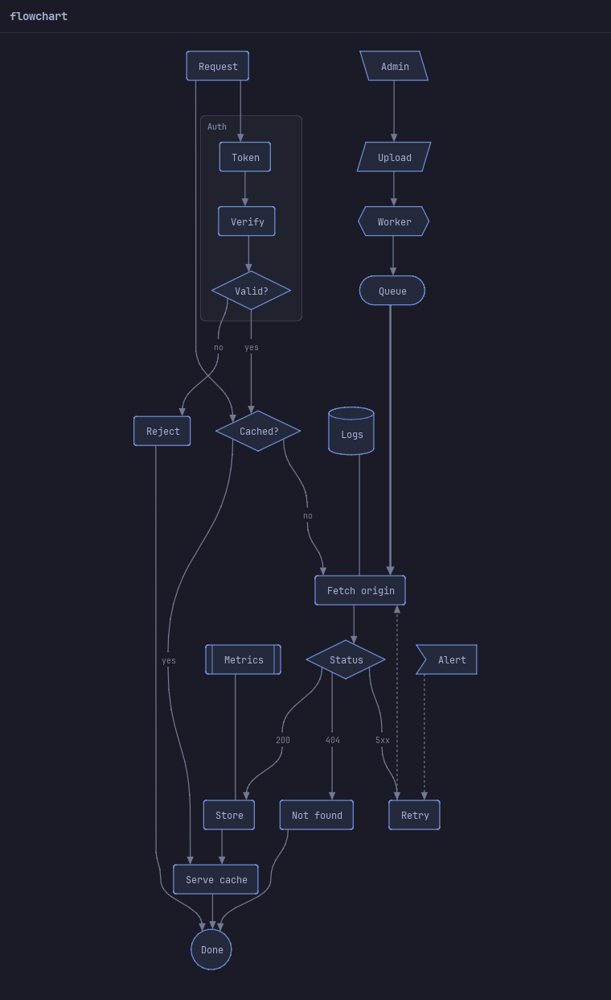
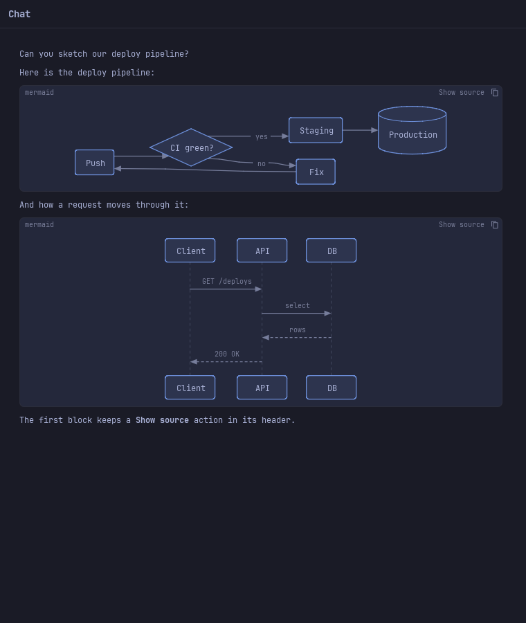
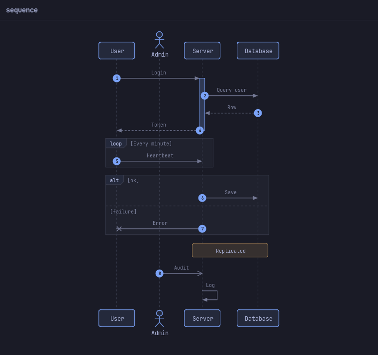
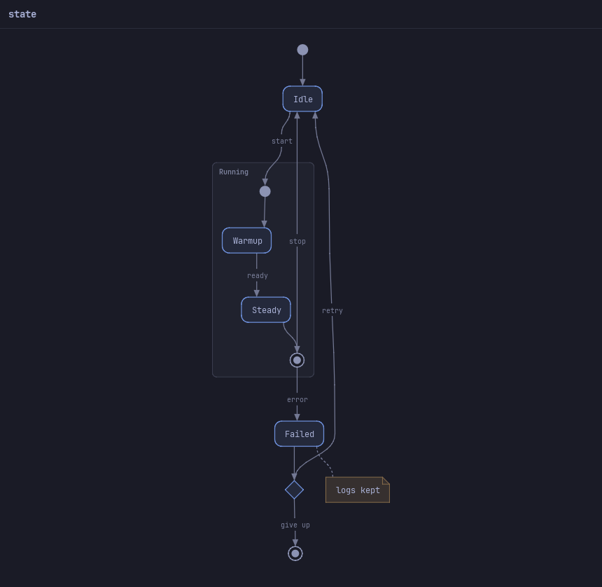

# Native Mermaid diagrams

Crate feature `mermaid` (off by default, no new dependencies, Rust 1.80).
Flowcharts, sequence diagrams and state diagrams are parsed, laid out and
drawn in Rust: shapes with the CPU [`gfx`](SHADERS.md) canvas at the
screen's pixel density, labels with FLTK and the theme font, colors from
the theme. This replaces o3-code's WebEngine Mermaid helper (150–240 MB)
for the common diagram types.

```toml
lib-fltk-omarchy = { ..., features = ["mermaid"] }
```



## API

```rust
use fltk_omarchy::mermaid::{self, MermaidView};
use fltk_omarchy::text::RichText;

// A scene you can draw yourself (or inspect in tests).
let d = mermaid::render("graph LR\n  A[Start] --> B{Ok?}\n  B -->|yes| C[Done]", 600.0)?;
println!("{} x {}, scale {}, {} items", d.width, d.height, d.scale, d.scene.items.len());

// A widget bound to a source.
let src = State::new("sequenceDiagram\n  A->>B: Hi".to_string());
let view = MermaidView::new("").bind(&src);   // resizes to the diagram's height

// Chat transcripts: closed ```mermaid fences become diagrams.
let chat = RichText::new().native_mermaid(true);
```

- `mermaid::render(src, max_width) -> Result<Diagram, Error>` uses the
  theme's body and caption sizes and FLTK measurement (needs an open
  display, like all text layout). `render_with(src, &Options, &mut dyn
  Measure)` takes explicit fonts, fitting and limits; `ApproxMeasure` is a
  fixed-pitch measure for headless use and tests.
- `Diagram { kind, width, height, scale, scene, summary }`: `scene.items`
  are `Item::Fill { points, role }`, `Item::Stroke { points, closed,
  width, dash, role }` and `Item::Text { lines, x, y, width, size,
  line_height, bold, role, align }`, in diagram pixels with the origin at
  the top left, already scaled to fit. `summary` is the diagram as text
  ("Flowchart: Request → Cached?; …") for screen readers and copying.
  `key()` hashes the source and options (caches).
- Colors are `Role`s (`NodeFill`, `NodeBorder`, `ClusterFill`,
  `ClusterBorder`, `Line`, `Text`, `Muted`, `Accent`, `NoteFill`,
  `NoteBorder`, `Marker`, `ActivationFill`, `Background`), resolved by
  `mermaid::color(role, &theme, under)` against the color drawn under the
  diagram: nodes are an accent tint with an accent border, edges the
  foreground at 62 %, notes a yellow tint. `omarchy-theme-set` restyles
  every diagram live.
- `mermaid::Picture` caches the rasterized shapes until the diagram, the
  pixel density, the theme or the color under it change; text is drawn on
  top at each paint. `rasterize` and `draw_text` are the two halves for
  custom widgets.
- `MermaidView`: `new`, `bind(&State<String>)`, `set_source`, `surface(ColorRole)`
  (paint on a card), `fit_height(bool)` (default on), `diagram()`,
  `error()`, `diagram_rect()`, `preferred_height(width)`. A source that
  does not render shows "Diagram: <reason>" and the source. Screen readers
  get an Image named by the summary.
- `detect(src) -> Option<Kind>` tells whether a source is one of the
  drawn types.

### In a RichText

`RichText::native_mermaid(true)` draws closed ```` ```mermaid ```` code
blocks as diagrams under the code header, which keeps the language label,
the copy button (copies the source) and a **Show source** action
(`mermaid::SHOW_SOURCE`; then **Show diagram**, `mermaid::SHOW_DIAGRAM`).
Both actions also reach `on_block_action`, so an app can remember the
choice. The app's own `code_actions` follow them.

- Streaming: while a fence is still open (the last block of a message
  whose stream tail has an odd number of fence lines) the block shows its
  code; when the closing fence arrives it is laid out again as a diagram.
  Nothing moves on screen until then, so a half-written diagram never
  flickers through layouts.
- A source that does not render (unknown type, past the limits, no nodes)
  stays an ordinary code block.
- Diagrams are laid out for the column width and cached by source (up to
  48 per view, least recently used dropped) until the width or the theme
  change. Selection, find and copy see the source text; with `a11y` the
  block is a Code node with the source.
- `RichText::mermaid_diagram(src)` returns the diagram drawn for a source
  (tests, tours).



## Supported syntax

**Flowcharts** (`graph` / `flowchart`, `TD` `TB` `BT` `LR` `RL`): node
shapes `[rect]`, `(round)`, `([stadium])`, `[[subroutine]]`,
`[(cylinder)]`, `((circle))`, `(((double circle)))`, `>asymmetric]`,
`{diamond}`, `{{hexagon}}`, `[/lean right/]`, `[\lean left\]`,
`[/trapezoid\]`, `[\inverted trapezoid/]`; links `-->`, `---`, `-.->`,
`-.-`, `==>`, `===`, `~~~` (invisible), `<-->`, `--o`, `--x`, and longer
forms (`--->`) for longer links; labels `-- text -->`, `-. text .->`,
`== text ==>`, `-->|text|`; chains (`A --> B --> C`), `&` groups, quoted
labels, `<br>` breaks, entity codes, nested `subgraph id [Title] … end`
(an edge to a subgraph id goes to its first or last member). `style`,
`classDef`, `class`, `:::class`, `linkStyle`, `click` are read and ignored:
colors always come from the theme. A left-to-right chart wider than the
room turns top-down when that is narrower.

**Sequence diagrams** (`sequenceDiagram`): `participant` / `actor` with
`as` aliases (participants also appear on first use, `create` reads as a
participant); messages `->`, `-->`, `->>`, `-->>`, `-x`, `--x`, `-)`,
`--)`, `<<->>`, `<<-->>`, self messages, `+`/`-` activation and
`activate` / `deactivate` bars; `Note left of|right of|over A[,B]`;
`autonumber [start [step]]` / `autonumber off`; `loop`, `alt`/`else`,
`opt`, `par`/`and`, `critical`/`option`, `break` frames and `rect` bands,
nested; `box … end` groups are read (no box is drawn). Heads are drawn
above and below the lifelines.

**State diagrams** (`stateDiagram` / `stateDiagram-v2`): `direction`,
`[*]` start and end states (one pair per composite), `state "Label" as
id`, `id : description` (drawn under the name), transitions `A --> B :
label`, `<<choice>>`, `<<fork>>` / `<<join>>`, composite `state X { … }`
(nested; `--` regions read as one), notes `note left of|right of X : text`
and multi-line `note … end note`. An edge to a composite goes to its start
state, an edge from it leaves its end state.

Comments (`%%`), `%%{init}%%` directives and front matter (`---
title: … ---`) are skipped. A statement that does not read is skipped and
the rest still draws.

 

Not drawn (they stay code): class, ER, gantt, pie, mindmap, timeline,
journey, git graphs and the other types; Rune's `rune-mermaid` covers
them and is the reference if they are needed later.

## Bounds

`Limits` (defaults): 32 KiB of source, 400 items (nodes + edges +
subgraphs, or participants + events), 300 characters per label (then
"…"), nesting 8 deep, 40 participants, 12 lines per wrapped label; the
layout refuses graphs whose long edges would need more than 3 000 bend
points. Past a bound `render` returns `Error::TooLarge(what)`; nothing
panics (unit tests feed truncated and randomly mangled sources).

## Cost

Release build, Linux X11 (Xvfb), theme font 13 px, `max_width` 720
(`cargo run --release --features mermaid --example mermaid -- --bench`):

| Diagram | Size | Parse + layout + scene | Scene | Shapes @1x / @2x | Picture @1x / @2x |
|---|---|---|---|---|---|
| Flowchart, 20 nodes, 23 edges, 1 subgraph | 440 × 1154 | 1.24 ms | 21 KiB | 7.0 ms / 24.5 ms | 1.9 MiB / 7.7 MiB |
| Sequence, 10 messages, 4 participants | 376 × 627 | 0.19 ms | 13 KiB | 4.9 ms / 17.9 ms | 0.9 MiB / 3.6 MiB |
| State, composite + choice + note | 266 × 750 | 0.67 ms | 10 KiB | 3.8 ms / 13.8 ms | 0.8 MiB / 3.0 MiB |

Layout and rasterization run once per source, width, density and theme;
a redraw after that is one image blit plus the labels (≈ 1 ms per view
including the window). A chat window with two native diagrams took
+394 KiB PSS over the same app without them; three `MermaidView` windows
with the diagrams above +1.5 MiB.

Binary size: `examples/richtext_minimal` (release, stripped) is 2 287 400
bytes; with `--features mermaid` (which turns `native_mermaid` on there)
2 605 544 bytes: **+311 KiB**, including the `gfx` rasterizer the plain
RichText binary does not link. Without the feature nothing is compiled.

## Gaps

- Colors from `style` / `classDef` / `linkStyle` are ignored (theme only).
- Edges to a subgraph or composite end at a member node, not at the
  frame's border.
- No streaming growth while a fence is open (Rune's `steady` layout keeps
  ranks and places while lines arrive); the code shows until it closes.
- Very wide diagrams shrink to 0.6 and are then clipped (no horizontal
  scroll yet); "Show source" is always there.
- Labels are plain text (no Markdown strings, icons or images).
- No hover highlighting of nodes and edges.

## Attribution

The layered layout (cycle breaking, doubled ranks, barycentre ordering
that keeps subgraphs together, isotonic placement, cluster boxes), the
edge routing with rank-axis cubics and label placement, the node shape
geometry, and the flowchart link/shape and sequence message grammars are
adapted from Rune's `rune-mermaid` crate (<https://github.com/anomalyco/rune>),
MIT License, Copyright (c) 2026 Anomaly. The full notice is in
`mermaid::NOTICE` (src/mermaid/mod.rs).
