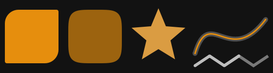
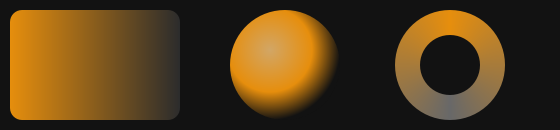
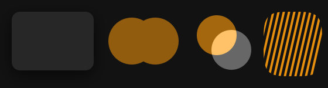

# Shapes, paints and CPU shaders (0.0.4)

`fltk_omarchy::gfx` draws custom visuals in **software**, on the CPU: no
GPU, no OpenGL and no extra fltk features. The crate keeps
`use-wayland` and `no-images`, so an app that depends on it builds exactly
as before. Colors come from the theme through `Uniforms`, so every visual
follows `omarchy-theme-set`.


```sh
cargo run --example shaders                                  # the window above, animated
cargo run --example shaders -- --snapshot docs/components    # re-render these pictures
```

## The five pieces

| Piece | What it is |
|---|---|
| `Path` | Vector shape: `move_to`, `line_to`, `quad_to`, `cubic_to`, `arc`, `close`; `rect`, `rounded_rect(x, y, w, h, [tl, tr, br, bl])`, `circle`, `ellipse`, `polygon`, `squircle(x, y, w, h, n)`; `translate`, `scale`, `rotate`; `contains(x, y)` and `near_outline(x, y, width)` for hit-testing |
| `Canvas` | Pixel buffer you draw on: `fill(&path, paint)`, `stroke(&path, &Stroke, paint)`, `clip(&path)` / `clipped(&path, \|c\| ..)`, `layer(opacity, blend, \|c\| ..)`, `shadow(&path, dx, dy, blur, color)`, `blur(x, y, w, h, radius)`; fields `opacity` and `blend` |
| `Paint` | `Color` (solid), `Paint::linear(from, to, stops)`, `Paint::radial(center, radius, stops)`, `Paint::conic(center, angle, stops)` |
| `Shader` | Any `Fn(x, y, &Uniforms) -> Color`, run for every pixel. `Uniforms` gives `time`, `frame`, `size`, `pointer`, the theme `background`, `foreground`, `accent` and `urgent`, and four free `params` |
| `View` | The widget: `.paint(\|c, u\| ..)`, `.shader(s)`, `.post(\|c, u\| ..)`, `.animate(fps)`, `.max_area(px)`, `.budget_ms(ms)`, `.hit_shape(Hit::Fill(path))`, `.on_click(f)`, `stats()` |

`Stroke::new(width).join(Join::Round | Join::Bevel | Join::Miter(limit)).cap(Cap::Butt | Cap::Round | Cap::Square)`.
`BlendMode`: `Normal`, `Multiply`, `Screen`, `Add`, `Darken`, `Lighten`.
`Color::hex("#e68e0d")`, `.with_alpha(a)`, `.mix(other, t)`; `Color::from(theme_rgb)`.

## Shapes



```rust
use fltk_omarchy::gfx::{Cap, Join, Path, Stroke, View};
let shapes = View::new(560, 150).paint(|c, u| {
    c.fill(&Path::rounded_rect(10.0, 20.0, 110.0, 110.0, [28.0, 4.0, 28.0, 4.0]), u.accent);   // radius per corner
    c.fill(&Path::squircle(140.0, 20.0, 110.0, 110.0, 4.5), u.accent.mix(u.background, 0.35));
    c.fill(&star(325.0, 75.0, 58.0, 26.0, 5), u.accent.mix(u.foreground, 0.3));          // Path::polygon (star(): examples/shaders.rs)
    let wave = Path::new().move_to(400.0, 110.0).cubic_to(430.0, 10.0, 470.0, 140.0, 545.0, 40.0);
    c.stroke(&wave, &Stroke::new(10.0).cap(Cap::Round), u.foreground.with_alpha(0.35));
    c.stroke(&wave, &Stroke::new(3.0).cap(Cap::Round), u.accent);
    let zig = Path::new().move_to(400.0, 135.0).line_to(430.0, 115.0).line_to(460.0, 135.0).line_to(490.0, 115.0);
    c.stroke(&zig, &Stroke::new(6.0).join(Join::Round).cap(Cap::Round), u.foreground);
    c.stroke(&zig.translate(60.0, 0.0), &Stroke::new(6.0).join(Join::Miter(4.0)), u.foreground.with_alpha(0.6));
});
```

Every edge is anti-aliased. Fills use the non-zero winding rule.

## Paints



```rust
use fltk_omarchy::gfx::{Paint, Path, View};
let paints = View::new(560, 130).paint(|c, u| {
    let (a, b, f) = (u.accent, u.background, u.foreground);
    c.fill(&Path::rounded_rect(10.0, 10.0, 170.0, 110.0, [12.0; 4]),
           Paint::linear((10.0, 0.0), (180.0, 0.0), &[(0.0, a), (1.0, b.mix(f, 0.15))]));
    c.fill(&Path::circle(285.0, 65.0, 55.0), Paint::radial((270.0, 50.0), 70.0, &[(0.0, a.mix(f, 0.5)), (0.6, a), (1.0, b)]));
    c.fill(&Path::circle(450.0, 65.0, 55.0), Paint::conic((450.0, 65.0), -PI / 2.0, &[(0.0, a), (0.5, f.mix(b, 0.5)), (1.0, a)]));
    c.fill(&Path::circle(450.0, 65.0, 30.0), b);
});
```

## Effects: shadow, layer opacity, blending, clip



```rust
use fltk_omarchy::gfx::{BlendMode, Color, Path, View};
let effects = View::new(560, 150).paint(|c, u| {
    let card = Path::rounded_rect(20.0, 20.0, 140.0, 100.0, [14.0; 4]);
    c.shadow(&card, 0.0, 8.0, 12, Color::rgba(0.0, 0.0, 0.0, 0.6));       // blur ≤ 32 px
    c.fill(&card, u.background.mix(u.foreground, 0.12));
    c.layer(0.6, BlendMode::Normal, |c| {                                   // group opacity
        c.fill(&Path::circle(225.0, 70.0, 40.0), u.accent);
        c.fill(&Path::circle(265.0, 70.0, 40.0), u.accent);
    });
    c.blend = BlendMode::Add;                                               // additive glow
    c.fill(&Path::circle(370.0, 60.0, 34.0), u.accent.with_alpha(0.7));
    c.fill(&Path::circle(395.0, 85.0, 34.0), u.foreground.with_alpha(0.5));
    c.blend = BlendMode::Normal;
    c.clipped(&Path::squircle(450.0, 20.0, 100.0, 110.0, 4.0), |c| { /* stripes */ });
});
```

## CPU shaders

A shader is a function of the pixel center, in widget pixels, and the
uniforms:

```rust
use fltk_omarchy::gfx::{self, Color, Uniforms, View};
// Built-in examples:
let noise = View::new(130, 110).shader(gfx::shaders::noise()).animate(30);        // fbm noise, theme bg → fg
let drift = View::new(130, 110).shader(gfx::shaders::gradient()).animate(30);     // bg → accent, drifting
let glow  = View::new(130, 110).shader(gfx::shaders::accent_glow()).animate(30);  // breathes; follows the pointer
// Background blur: blobs, the panel area blurred, a translucent card on top.
let frosted = View::new(130, 110).shader(gfx::shaders::blobs())
    .post(|c, u| {
        c.blur(15, 25, 100, 60, 10);
        c.fill(&gfx::Path::rounded_rect(15.0, 25.0, 100.0, 60.0, [10.0; 4]), u.background.with_alpha(0.25));
    })
    .animate(30);
// Your own:
let rings = View::new(200, 200).shader(|x: f32, y: f32, u: &Uniforms| {
    let d = ((x - u.size.0 / 2.0).powi(2) + (y - u.size.1 / 2.0).powi(2)).sqrt();
    u.background.mix(u.accent, (0.5 + 0.5 * (d * 0.15 - u.time * 3.0).sin()) * 0.6)
}).animate(30);
```

Helpers: `gfx::shaders::{value_noise, fbm, hash2}`.

"Background blur" means blurring what the same View drew: its shader, or
what `paint` drew before. It cannot blur other widgets, because FLTK gives no
cheap access to the pixels behind a widget.

### Limits that keep the UI responsive

- **Area limit** (`max_area`, default 160 000 px): a larger View renders
  at a lower resolution and is scaled up when drawn. Shaders and `paint`
  still get widget coordinates. Memory per View is bounded by it: two
  4-byte buffers plus one upload buffer.
- **Time budget per draw** (`budget_ms`, default 6 ms): shaders render in
  32 × 32 tiles. When a frame needs more time, it continues on the next
  draw and the last complete frame stays on screen. The first frame always
  completes.
- **Buffer reuse**: the frame buffers and the upload buffer are kept
  between frames and given back when the View shrinks a lot. Opaque
  shader output takes an RGB fast path.
- **Animation** (`animate(fps)`, ≤ 120) uses an fltk timer, never a loop.
  While the View or its window is hidden, ticks are skipped: no render,
  0.5 s polling.
- **Regions**: a static View renders only when it is invalidated (theme
  change, `set_params`, `invalidate()`, the pointer moving over a shader
  View). An animated View re-renders all of its pixels each tick.
- `stats()` reports `frames`, `partial_draws`, `last_frame_ms`,
  `last_blit_ms`, `render_size`, `paused_ticks` and `memory`.

## Non-rectangular widgets

```rust
use fltk_omarchy::gfx::{Hit, Paint, View};
let shape = star(60.0, 45.0, 42.0, 20.0, 6);
let button = View::new(120, 90)
    .paint({ let s = shape.clone(); move |c, u| c.fill(&s, u.accent) })
    .hit_shape(Hit::Fill(shape))          // or Hit::Outline(path, width)
    .on_click(|| println!("inside the star"));
```

Outside the shape, mouse events go to whatever is below, as if the View
were not there. With `on_click` the View is also a keyboard control: Tab
reaches it, Enter or Space press it, and the focus ring follows the shape.

## Cost (measured)

Same session on 2026-10-28, Asahi Linux (Apple M2), Hyprland, release
build (`opt-level = "s"`, thin LTO). The setup: a 520×400 window with one
View rendered at 484×300, on a hidden workspace, 3 runs of 5 s each
(`script/gfx-bench`; raw data in `docs/gfx-bench-2026-10-28.jsonl`). The
table shows medians. PSS includes SwapPss and covers the whole process
tree.

| Case | fps | CPU | CPU per frame | View render | Blit | PSS |
|---|---|---|---|---|---|---|
| Static (rendered once) | — | 0.0 % | — | 5.1 ms once | 1.6 ms | 20.5 MB |
| `noise` animated | 30 | 43.2 % | 14.4 ms | 11.1 ms | 3.4 ms | 19.3 MB |
| `noise` animated, `max_area(40_000)` (254×157) | 30 | 28.3 % | 9.4 ms | 5.2 ms | 4.0 ms | 17.9 MB |
| `gradient` animated | 30 | 35.7 % | 11.9 ms | 2.8 ms | 2.1 ms | 19.4 MB |

How to read it:
- Animation costs CPU, not memory: PSS was the same as the static View
  (19.3–20.5 MB in both).
- A full-size animated shader at 30 fps uses 35–45 % of one core. Lower
  `max_area` or the fps for decorative backgrounds.
- "CPU per frame" covers the whole process: shader, blit, fltk and Wayland
  flush, and the extra draws when a frame exceeded the budget. The View
  render and blit columns are the View's own share.

Not measured: GPU-heavy content (not supported), multi-core shading (tiles
run on the UI thread), and other machines.

## GPU

Not implemented. Enabling fltk's `enable-glwindow` in this crate would
change the fltk-sys build of every app that depends on it, because Cargo
unifies features (Files has a header guard that would break). If it is ever
added, it will be an optional crate feature, **off by default**, in its own
module, with its memory and startup cost measured and documented. The
software path stays the default.
